  

### Tech stack

<table>
  <tr>
    <td><b>LINGUAGENS</b></td>
    <td>
      
      
      
      
      
    </td>
  </tr>
  <tr>
    <td><b>BACKEND</b></td>
    <td>
      
      
      
      
      
      
      
    </td>
  </tr>
  <tr>
    <td><b>FRONTEND</b></td>
    <td>
      
      
      
      
      
    </td>
  </tr>
  <tr>
    <td><b>DADOS & FILAS</b></td>
    <td>
      
      
      
      
      
    </td>
  </tr>
  <tr>
    <td><b>DEVOPS & TESTES</b></td>
    <td>
      
      
      
      
      
      
    </td>
  </tr>
  <tr>
    <td><b>ARQUITETURA</b></td>
    <td>DDD · MVP · Feature-Sliced Design · Microsserviços · BFF · SOLID · TDD · Scrum · Kanban</td>
  </tr>
</table>

### Experiência

**Unimed Noroeste RS** · Analista de Desenvolvimento de Sistemas · jun/2026 – atual
- Evoluo o CRM desktop (Java/Swing, JDBC, PostgreSQL) usado por **181 pessoas em 6 setores**: mais de 60 entregas.
- Mantenho as APIs Spring Boot que ligam o CRM ao Tasy, ao ERP (SQL Server) e à ClickSign.
- Construí a base do **novo CRM Web**: React 19, TypeScript, Ant Design, Feature-Sliced Design, BFF Spring Boot e deploy em Docker via GitLab CI.
- Diagnostiquei um travamento no SQL Server de produção que prendeu 52 sessões.

**Mérito Engenharia de Software** · Desenvolvedor Pleno / Java Full Stack · jul/2025 – mai/2026
- Microsserviços em Java 17+/Spring Boot e Node.js/TypeScript com DDD, integrados por RabbitMQ/JMS.
- Telas em Angular 17+ com acessibilidade WCAG e cobertura de testes acima de 85% com TDD.

### Projeto em destaque

**[GHOrg](https://github.com/BiroIgor/github-crawler-api)**: API e crawler de organizações do GitHub em Node.js/TypeScript (Express), com coletas enfileiradas no RabbitMQ (DLQ e retentativas), PostgreSQL + MongoDB e DDD em 4 camadas, tudo em Docker Compose.

### Contribuições

  

